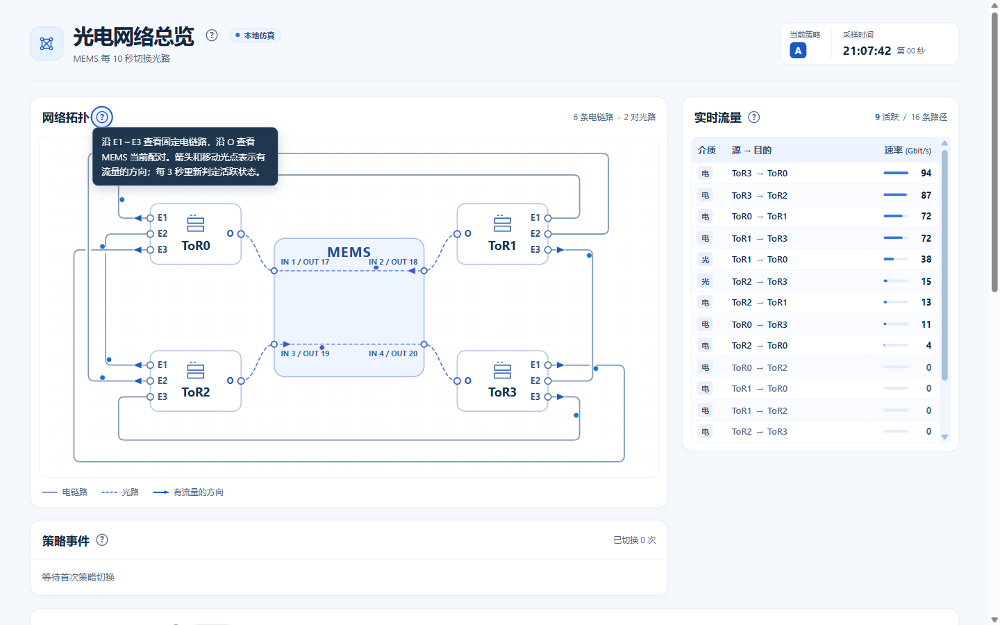
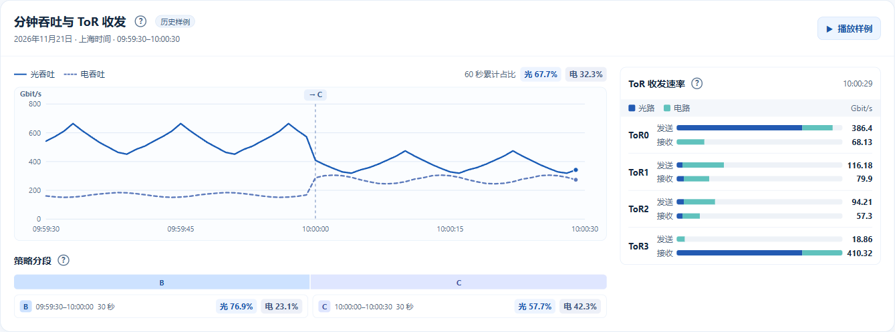
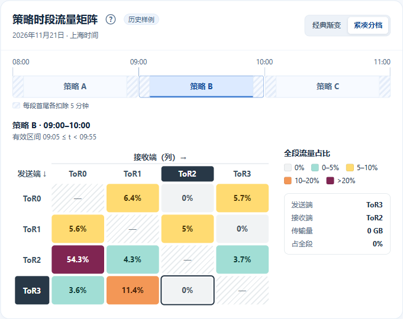

# 光电网络总览

这是一个可离线演示的光电混合网络前端。打开页面即可观察 4 台 ToR 之间的传输方向、MEMS 光路配对及每条路径的模拟速率。页面下方提供可回放的历史样例，便于比较策略切换前后的吞吐与流量分布。

**模块帮助**　将指针移到标题旁的圈问号上可查看该模块的读图或操作说明。键盘可用 Tab 聚焦问号、Esc 关闭；触屏可点问号打开、点空白处关闭。



## 如何读实时总屏

| 模块 | 看什么 |
|---|---|
| 光电网络总览 | 右上角是当前模拟策略及采样时刻。历史样例单独显示自己的观察时段。 |
| 网络拓扑 | 每台 ToR 的 E1～E3 连接电路，O 接入 MEMS。沿光点方向追踪传输，MEMS 框内的配对随策略变化。 |
| 实时流量 | 按“介质、源、目的”分别统计每个方向，并按速率降序排列。默认 4 ToR 共 16 个方向，包括 12 个电方向和 4 个已接通的光方向。 |
| 策略事件 | 按时间倒序记录策略切换与新配对。可对照同一时刻的拓扑，核对哪两台机架已接通。 |

默认展示 4 台 ToR。每个可用方向在第 0 秒首次随机决定有无流量，之后每 3 秒重新判定。活跃方向的速率每秒重新采样，空闲方向保持 0。固定尺寸的光点沿活跃方向连续移动，双向光点沿基础接线两侧移动。启用系统的减少动态效果选项时，沿源端箭头识别活跃方向。

MEMS 每 10 秒按 A → B → C → A 切换光路，并同步记录事件。新接通的光路立即判定有无流量，随后与其他方向一起在下一个 3 秒节点重新判定。所有模拟数据由浏览器生成。

## 启动

在本目录用 PowerShell 执行。开发和构建需要 Node.js 20.19+ 或 22.12+。

```powershell
npm.cmd ci
npm.cmd run dev
```

打开 [本地开发页](http://127.0.0.1:5173/)。

## 构建并打开生产页面

```powershell
npm.cmd run build
npm.cmd run preview
```

打开 [本地生产预览](http://127.0.0.1:4173/)。`dist/` 可整目录复制到任意静态 HTTP 服务的根路径或子路径。若只运行已构建的文件，在项目根目录执行 `node tests/integration/static-server.mjs dist 4173` 即可，静态服务脚本使用 Node 自带模块。

## 演示参数

- URL 加 `?tors=8` 可打开 8 ToR 扩容样例。样例位于 `src/sim/cluster8.mjs`，每组内两两走电，B/C 策略走跨组光路。
- 默认接线在 `src/sim/config.mjs`。采样间隔由 `src/main.jsx` 管理。活跃概率 0.5、活跃速率 1–100 Gbit/s、换路周期 10 秒定义在 `src/sim/index.mjs`。

## 历史样例

在实时拓扑下方查看两个独立的历史区域。分钟图默认打开上海时间 `[09:59:30, 10:00:30)`。点击「播放样例」逐秒推进，右侧显示窗口最后一秒的 ToR 收发。整窗和分段的光电占比都按累计 Gbit 计算。

- **分钟吞吐**用实线和虚线分别显示光、电总速率。竖向刻线标出策略切换，播放、暂停仅控制历史窗口。
- **策略分段**的色带按持续秒数分配宽度。下方百分比表示各段内部的承载占比，整分钟占比由该分钟的光、电累计传输量计算。
- **ToR 收发速率**每台机架有发送、接收两根横条。深蓝段为光路，青绿段为电路；所有机架共用当秒刻度，末端读数为该方向的合计 Gbit/s。



策略矩阵默认显示 09:00–10:00，点击时间线中的策略区段切换。每段扣除首尾各 5 分钟。点击或聚焦单元格查看有向路径的 GB 和全段占比。三个时段共用一套色标。4 ToR 与 `?tors=8` 使用同一组计算规则。

矩阵的行是发送端，列是接收端。右上角可在默认的「经典渐变」宽表和「紧凑分档」之间切换，两种样式共用数据并保留所选时段与流向。图中 ToR2 行、ToR0 列的 54.3% 表示，在策略 B 的有效统计时段内，从 ToR2 发往 ToR0 的流量占全网传输量的 54.3%。



## 复验

```powershell
node --test tests/sim/simulation.test.mjs
node --test tests/analytics/aggregate.test.mjs
node tests/ui/check.mjs
npm.cmd run build
node tests/integration/flow-motion.mjs
node tests/integration/check.mjs
node tests/integration/history-check.mjs
```

浏览器检查使用本机安装的 Google Chrome，并独立启动和关闭各自的 HTTP 服务。动画检查逐帧核对光点在速率更新前后的连续性。生产集成检查以前台时钟观察至少 21 秒，随后使用测试时钟检查窄屏和 8 ToR。
